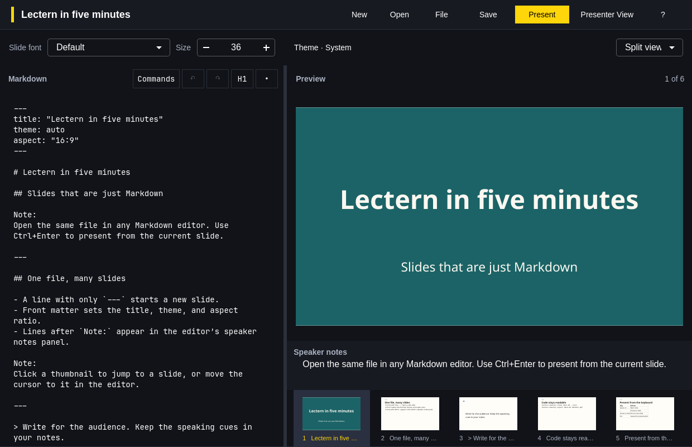

# Lectern for Omarchy



Lectern edits and presents plain Markdown slide decks on Omarchy. Open a deck, edit it beside a live preview, present it fullscreen, or export it as a PDF. The editor, presentation, and PDF share the same Qt renderer.

## Run

```sh
bin/build
build/lectern-omarchy open docs/example.md
bin/test
```

Build with GCC, make, qmake6, Qt Base, and Qt Declarative. The Arch package adds Qt Wayland, Qt SVG, and the desktop portal as runtime dependencies.

```sh
(cd pkgbuild && makepkg)  # Build the package
bin/install              # Build and install through pacman
```

File selection uses the [XDG Desktop Portal file chooser](https://flatpak.github.io/xdg-desktop-portal/docs/doc-org.freedesktop.portal.FileChooser.html). The package adds **Lectern** to the Omarchy launcher and registers it as a Markdown file handler. The app follows Omarchy’s accent, Hyprland rounding, and language setting. English and Danish are bundled.

## Updates

Select **Updates** in the sidebar to check the latest stable [GitHub release](https://github.com/mrelph/lectern-omarchy/releases/latest). For a user-local installation at `~/.local/bin/lectern-omarchy`, select **Install update** when a matching Linux binary is available. Lectern verifies the GitHub release asset’s SHA-256 digest before replacing the executable. Restart Lectern to run the new version.

For a system installation, select **View release** and install the matching Arch package with `sudo pacman -U <package>`. The first release includes prebuilt x86_64 assets.

### Publishing a release

Set `VERSION`, commit, and tag that commit with the corresponding `vX.Y.Z` tag. Build the Arch package from that checkout and upload both the package and its executable to the stable GitHub release. Name the executable `lectern-omarchy-linux-x86_64` or `lectern-omarchy-linux-arm64` to match Qt’s reported build architecture.

## Deck format

Write Markdown in a UTF-8 file. A line containing only `---` starts a new slide outside fenced code. Start a speaker notes section with `Note:` or `Notes:`. The preview shows those notes below the slide, and the presentation and PDF omit them.

An optional opening front matter block accepts `title`, `aspect` (`16:9` or `4:3`), `theme` (`auto`, `light`, or `dark`), `font`, and `code-font`. Fonts come from the system. Relative image paths resolve alongside the saved Markdown file. See the [example deck](docs/example.md).

Open decks reload when an external editor saves them. When a disk change collides with unsaved edits, **Save As** keeps your version in a separate file.

## Keyboard

| Key | Action |
| --- | --- |
| Ctrl+N / Ctrl+O | New / open |
| Ctrl+S / Ctrl+Shift+S | Save / Save As |
| Ctrl+Z / Ctrl+Shift+Z | Undo / redo in the source editor |
| Ctrl+Shift+E | Export PDF |
| Ctrl+Enter | Toggle fullscreen presentation |
| Space | Start presenting when focus is outside the editor |
| → / ↓ / Space / Enter | Next slide while presenting |
| ← / ↑ | Previous slide while presenting |
| Home / End | First / last slide while presenting |
| Esc | Leave presentation |
| F1 / ? | Keyboard help |
| Ctrl+Q | Quit |

## Headless commands

```sh
lectern-omarchy info deck.md --json
lectern-omarchy check deck.md --json
lectern-omarchy export deck.md deck.pdf --json
lectern-omarchy skill install
```

`check` exits 1 for an empty slide, an unclosed code fence, or an unsupported aspect or theme. For PDF exports, `--dark` selects dark rendering for decks with `theme: auto`. Choose a new output path for each CLI export.

## Swift repository review

The original Lectern for macOS separates the deck parser and editor into `LecternCore`, the AppKit slide renderer and exporters into `LecternRender`, and the CLI and stdio MCP into `LecternTool`. The SwiftUI and AppKit frontend adds the folder library, native document handling, presentation controllers, and Ephy integration. The Linux project keeps the Markdown document contract and the shared renderer architecture. Qt renders the slides, so typography and layout can differ between platforms.

The initial Omarchy release covers editing and presenting single decks. macOS features outside this release include the folder library, second-display presenter view, transitions, PNG export, slide mutation commands, MCP, and Ephy.
